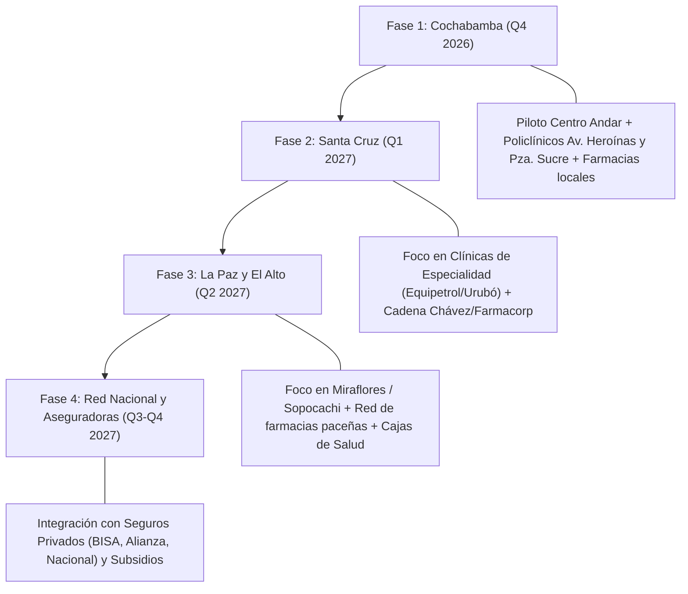

# Estudio de Mercado, Propuestas de Marca y Estrategia Comercial
## Sistema de Receta Digital Interconectada con Farmacias en Bolivia

**Documento:** Investigación de Mercado y Plan Go-To-Market  
**Autor:** Antigravity AI & Spec Kit Architecture  
**Fecha:** Octubre 2026  
**Ámbito Geográfico:** Bolivia (Cochabamba, Santa Cruz, La Paz y eje nacional)  
**Clínica Piloto / Caso de Éxito:** Centro Andar (Pie Diabético e Infectología)  

---

## 1. Resumen Ejecutivo

El sector de la salud ambulatoria y la dispensación farmacéutica en Bolivia se encuentra en un punto de inflexión. Mientras el 85% de la población urbana utiliza activamente smartphones y WhatsApp como canal primordial de comunicación y comercio, **el 92% de las prescripciones médicas continúan emitiéndose en talonarios de papel manuscritos**, con serios problemas de ilegibilidad, falsificación, falta de validación de alergias y un total divorcio entre el consultorio médico y el inventario real de las farmacias.

Este sistema nace como la primera **Plataforma Integral de Receta Digital Interconectada** diseñada desde cero para la realidad clínica y operativa boliviana:
- Permite a clínicas y centros médicos (como *Centro Andar*) personalizar su identidad, subir su logotipo, registrar a sus especialistas y gestionar a sus pacientes con historial de alergias y antecedentes patológicos.
- Conecta la prescripción médica estandarizada con **CIE-11** y catálogo farmacológico con el stock en tiempo real de las farmacias.
- Notifica al paciente al instante por **WhatsApp** con su código alfanumérico único de retiro (RX), código QR y pre-orden farmacéutica lista para retiro.

---

## 2. Tres (3) Propuestas de Nombres de Marca

Para el lanzamiento comercial y posicionamiento en el mercado boliviano y latinoamericano, se plantean tres alternativas con distinto enfoque estratégico:

### Propuesta 1: **RecetaMed** (o **RecetaMed Bolivia**)
> *"La red inteligente que conecta médicos, pacientes y farmacias."*

* **Concepto y Narrativa:** Nombre claro, directo y con cero fricción de entendimiento. Une los dos términos esenciales: *Receta* y *Medicina*. Es un nombre institucional que genera confianza inmediata tanto en médicos sénior como en farmacéuticos de cadena y de barrio.
* **Arquetipo de Marca:** El Cuidador y El Sabio (Institucional, seguro, formal, avalado por la comunidad médica).
* **Público Objetivo Principal:** Consultorios privados, policlínicos, colegios médicos departamentales y cadenas farmacéuticas tradicionales.
* **Dominios y Redes Sugeridos:** `recetamed.bo`, `recetamed.com.bo`, `recetamed.app`.
* **Ventaja Competitiva del Nombre:** Fácil de pronunciar, memorable, sin barreras idiomáticas y con posicionamiento SEO orgánico inmediato para búsquedas de salud en Bolivia.

---

### Propuesta 2: **FarmaLink** (o **FarmaLink 360**)
> *"Prescripción digital y dispensación en tiempo real."*

* **Concepto y Narrativa:** Nombre moderno con vocación de plataforma SaaS B2B. Resalta la palabra clave fundamental: **Link (Interconexión)**. No es solo un generador de PDFs, sino el eslabón digital que vincula el acto médico con la cadena de suministro farmacéutico.
* **Arquetipo de Marca:** El Conector y El Creador (Innovador, tecnológico, ágil, orientado a la eficiencia de procesos).
* **Público Objetivo Principal:** Cadenas de farmacias (*Farmacorp*, *Farmacias Chávez*), clínicas privadas de vanguardia, startups de telemedicina y aseguradoras de salud.
* **Dominios y Redes Sugeridos:** `farmalink.bo`, `farmalink.lat`, `farmalink360.com`.
* **Ventaja Competitiva del Nombre:** Proyecta una solución escalable regionalmente (no limitada a Bolivia), ideal si a futuro se busca expandir la solución a Paraguay, Perú u otros mercados andinos.

---

### Propuesta 3: **AndesRx** (o **KuraRx**)
> *"Salud digital trazable desde el consultorio hasta la farmacia."*

* **Concepto y Narrativa:** Combina la identidad regional de la cordillera andina (cuna del proyecto en Cochabamba) con el símbolo universal de la prescripción médica facultativa (**Rx**, del latín *recipe* / *"tómese"*). Transmite prestigio científico, raíces locales y estándares médicos de clase mundial.
* **Arquetipo de Marca:** El Pionero y El Protector (Prestigioso, especializado, con orgullo identitario boliviano).
* **Público Objetivo Principal:** Centros médicos de alta especialidad (pie diabético, infectología, oncología, traumatología), redes hospitalarias privadas y médicos especialistas.
* **Dominios y Redes Sugeridos:** `andesrx.bo`, `andesrx.com`, `kurarx.health`.
* **Ventaja Competitiva del Nombre:** Excelente resonancia para clínicas de especialidad y centros de referencia médica como el Centro Andar.

---

## 3. Investigación Exhaustiva del Mercado en Bolivia

### 3.1 Marco Regulatorio e Institucional
1. **Ministerio de Salud y Deportes & AGEMED (Agencia Estatal de Medicamentos y Tecnologías en Salud):**
   - Rige bajo la **Ley del Medicamento Nº 1737** y su Decreto Reglamentario Nº 25235.
   - Establece que la receta médica es un documento legal de exclusiva potestad de profesionales médicos, odontólogos y veterinarios habilitados con **Matrícula Profesional del Ministerio de Salud**.
   - Exige la prescripción por Nombre Genérico o Denominación Común Internacional (DCI), indicando concentración, forma farmacéutica y dosificación.
   - Los psicotrópicos y estupefacientes requieren obligatoriamente la **Receta Médica Archivada o Valorada**, sujeta a control estricto de libros de farmacia.
2. **Ley Nº 3131 del Ejercicio Profesional Médico:**
   - Define a la receta y a la historia clínica como componentes protegidos por el secreto profesional y con validez legal ante auditorías médicas y peritajes judiciales.
3. **Firma Digital (ADSIB - Agencia para el Desarrollo de la Sociedad de la Información en Bolivia):**
   - Respaldada por la **Ley General de Telecomunicaciones y TIC (Ley Nº 164)** y DS 1793.
   - La ADSIB es la Entidad Certificadora Pública de Bolivia que emite certificados digitales y tokens criptográficos. Un documento firmado digitalmente con token ADSIB posee la misma validez jurídica y probatoria que una firma manuscrita con sello físico.

---

### 3.2 Mapa de Competidores y Soluciones Actuales en Bolivia

| Sistema / Actor | Enfoque Principal | Emisión de Receta | Interconexión con Farmacia | Estado / Limitaciones en Bolivia |
| :--- | :--- | :--- | :--- | :--- |
| **TuDoc** (`tudoc.com.bo`) | Software de consultorio médico local | Sí (PDF básico con LINAME) | ❌ No tiene conexión con farmacias | Enfocado en agenda y caja chica en bolivianos. La receta termina impresa en papel. |
| **Nexodoc** (`nexodoc.com`) | Agenda y telemedicina | Sí (plantillas) | ❌ No tiene conexión con farmacias | No valida stock en farmacias ni alerta al químico farmacéutico. |
| **Clínicapp** (`clinicappoficial.com`) | App para pacientes y teleconsulta | Sí (descarga en app) | ❌ Desconectado de farmacias | Requiere que el paciente descargue una app pesada (gran fricción). |
| **Medexplorer** (`medicos.com.bo`) | Directorio médico y órdenes de lab | Sí (órdenes digitales) | ❌ Sin enlace a inventario farmacéutico | Muy enfocado en directorio publicitario de doctores. |
| **Sistemas Propios de Hospitales** (Clínica Foianini, Los Olivos, Univalle) | ERPs hospitalarios cerrados (SAP, desarrollos a medida) | Sí (intrahospitalaria) | ⚠️ Solo con la farmacia interna del hospital | Sistemas cerrados que no operan con farmacias de calle ni consultorios independientes. |
| **Cadenas de Farmacias** (*Farmacorp*, *Farmacias Chávez*) | Puntos de venta (POS) y comercio electrónico propio | ❌ No emiten recetas médicas | ⚠️ Solo venta directa o delivery de productos libres | Dependen de que el cliente les traiga un papel o les mande una foto borrosa por WhatsApp. |

### 3.3 El Gran Vacío del Mercado
Ningún sistema en Bolivia conecta actualmente **al médico independiente o clínica privada con el mostrador de la farmacia en tiempo real**. El médico prescribe "a ciegas" sin saber si la farmacia tiene el antibiótico o apósito disponible, y el paciente deambula por varias farmacias buscando quién le surta la receta.

---

## 4. Problemas Críticos que Resuelve el Sistema

### 4.1 Para los Médicos y Centros Médicos
1. **Eliminación de errores de prescripción y letra ilegible:** Prescripción asistida mediante catálogo de medicamentos, dosis estándar y códigos oficiales **CIE-11**.
2. **Seguridad clínica y protección legal:** Detección visual inmediata de **alergias farmacológicas** (ej. Penicilina, Sulfas, Ciprofloxacino) y antecedentes del paciente (Diabetes, Pie Diabético, Hipertensión).
3. **Construcción de marca y prestigio institucional:** Clínicas como el Centro Andar proyectan una imagen tecnológica premium al entregar recetas digitales con su logotipo oficial, datos de contacto y código QR de validación.
4. **Agilidad en la consulta:** Generación de la receta en menos de 45 segundos, con cálculo automático de fecha de fin de tratamiento y posología estructurada.

### 4.2 Para las Farmacias (Cadenas e Independientes)
1. **Reducción del 90% en el tiempo de atención en caja:** En lugar de perder 4 a 6 minutos intentando descifrar la letra manuscrita del médico y buscando el medicamento en el sistema, el farmacéutico solo ingresa el código alfanumérico (ej. `RX-78491`) o escanea el QR y la comanda aparece precargada.
2. **Cero errores de dispensación:** Se despacha exactamente el principio activo, concentración y presentación prescritos, protegiendo a la farmacia ante auditorías del SEDES o denuncias por negligencia.
3. **Flujo asegurado de pacientes referidos:** Las farmacias aliadas reciben recetas digitales asignadas directamente desde el consultorio médico, aumentando su ticket promedio y fidelizando pacientes.
4. **Gestión proactiva del stock:** La farmacia recibe una alerta previa en su portal web para preparar el pedido antes de que el paciente llegue al mostrador.

### 4.3 Para los Pacientes
1. **Receta siempre disponible en WhatsApp:** Se acabó el problema de recetas perdidas, rotas o manchadas en la cartera o bolsillo.
2. **Certeza antes de salir de casa:** El paciente sabe con exactitud a qué farmacia acudir, su dirección, horario de atención y que sus medicamentos ya están reservados.
3. **Instrucciones claras y legibles:** Horarios de toma, duración del tratamiento y recomendaciones específicas (ej. *"No consumir alcohol"*, *"Tomar con alimentos"*) escritas con claridad meridiana.

---

## 5. Estrategia Comercial y Go-To-Market (Cómo Venderlo en Bolivia)

### 5.1 Cómo Ofrecerlo a los Médicos y Centros Médicos

#### Argumentario de Ventas (Pitch Médico)
> *"Doctor(a), ¿cuántas veces a la semana le llaman de la farmacia porque no entienden una indicación, o sus pacientes le escriben angustiados porque el medicamento que recetó está agotado? Con nuestro sistema, usted emite recetas digitales con el logotipo de su clínica en 30 segundos, verifica alergias en pantalla y su paciente recibe su receta oficial al instante en WhatsApp, con los medicamentos ya reservados en farmacia."*

#### Estrategia de Captación:
1. **Alianzas con Sociedades Científicas y Colegios Médicos:** Presentar el sistema en congresos de la *Sociedad Boliviana de Infectología*, *Sociedad de Medicina Interna*, *Sociedad de Endocrinología y Diabetes* y *Sociedad Boliviana de Pediatría*.
2. **Modelo Freemium / Prueba Gratuita de 30 días:** Permitir a los consultorios emitir hasta 50 recetas gratis al mes para comprobar el ahorro de tiempo y el agrado de sus pacientes.
3. **Planes de Suscripción Flexibles:**
   - **Plan Consultorio Individual:** ~150 a 200 BOB/mes por médico (recetas ilimitadas, directorio de pacientes, exportación PDF y WhatsApp).
   - **Plan Clínica / Centro Médico (Multi-Especialidad):** ~600 a 1.200 BOB/mes (logotipo personalizado, múltiples médicos, soporte técnico prioritario).

---

### 5.2 Cómo Ofrecerlo a las Farmacias

#### Estrategia Dual: Grandes Cadenas vs. Farmacias Independientes

#### A) Cadenas Grandes (*Farmacorp*, *Farmacias Chávez*, *Farmaval*)
* **Propuesta de Valor:** Integración como canal asistido de ventas digitales. La receta digital redirige pacientes directamente a sus sucursales más cercanas.
* **Modelo B2B:** Integración mediante API directa a su software POS. Cobro por transacción dispensada exitosa (~1 a 2 BOB por receta dispensada) o tarifa corporativa fija por sucursal interconectada.
* **Gancho comercial:** Aumento en la tasa de conversión y reducción drástica de tiempos de espera en cajas de sus sucursales más concurridas.

#### B) Farmacias Independientes y de Barrio
* **Propuesta de Valor:** "La tecnología de las grandes cadenas al alcance de su farmacia".
* **Gancho comercial:** Les permite conectarse con los médicos de su zona (en un radio de 500 metros alrededor de clínicas y hospitales) para que los pacientes retiren en su local en vez de irse a las cadenas.
* **Modelo B2B:** Suscripción mensual de bajo costo (~100 BOB/mes) que incluye el panel de farmacia, control de inventario de medicamentos clave y recepción de recetas.

---

### 5.3 Hoja de Ruta de Expansión Geográfica en Bolivia

---

## 6. Características Clave Adicionales para el Roadmap (Futuras Versiones)

Para consolidar el liderazgo en Bolivia, se recomienda incorporar las siguientes funcionalidades en las próximas iteraciones de desarrollo:

### 1. Integración con Firma Digital ADSIB
- Incorporar firma de PDFs mediante el software oficial **Jacobo / Firma Digital ADSIB** con token criptográfico USB o firma en la nube (PKI Bolivia), cumpliendo al 100% con los requerimientos legales para auditorías sanitarias del SEDES.

### 2. Módulo Especial de Receta Archivada (AGEMED)
- Soporte para medicamentos controlados (Lista II y III: psicotrópicos, benzodiacepinas, opioides) con generación de los formularios oficiales exigidos por AGEMED (doble folio con número de serie y campos de retención obligatoria en farmacia).

### 3. Motor Inteligente de Interacciones Farmacológicas
- Alerta en tiempo real en la pantalla del médico si se prescriben dos medicamentos que interactúan negativamente (ej. Ciprofloxacino + Antiácidos, o Warfarina + AINEs) o si el paciente tiene una contraindicación registrada en sus antecedentes.

### 4. Integración con Facturación Electrónica en Línea (SIAT del SIN)
- Conexión del módulo de farmacia con el Servicio de Impuestos Nacionales (SIN) para que, al despachar la receta, se emita automáticamente la factura electrónica con código QR y CUF al NIT/CI del paciente.

### 5. Portal PWA para el Paciente con Alertas de Toma
- Una versión web progresiva ultraligera que no requiera descarga desde tiendas de apps, donde el paciente vea su receta, el horario de sus medicamentos y reciba notificaciones push o mensajes automáticos de WhatsApp cuando deba tomar su próxima dosis.

---

## 7. Conclusión y Próximos Pasos

El sistema desarrollado para **Centro Andar** cuenta con la solidez técnica, usabilidad y arquitectura modular necesaria para convertirse en el estándar de receta digital interconectada en Bolivia. 

Al cerrar la brecha entre el consultorio médico, el inventario de las farmacias y el teléfono del paciente, la plataforma no solo moderniza el acto médico, sino que salva vidas al erradicar los errores de dosificación y garantizar que los pacientes con enfermedades complejas (como pie diabético e infecciones graves) reciban sus fármacos a tiempo.
